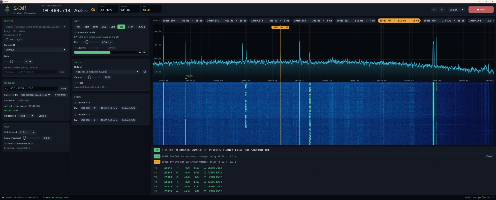

<p align="center"></p>

# SeDiR



Wideband SDR receiver written in Rust: a colour spectrum and waterfall over the widest band
your receiver can carry, with every signal in view found and listed. Click a signal and it
is recognised, tuned and demodulated.

*Sedir* is the Taurus cedar that grows in Muğla, Turkey.

**Türkçe açıklama:** [aşağıda](#türkçe).

## Features

- **Receivers found automatically:** RTL-SDR, HackRF One, ADALM-Pluto, LibreSDR and other
  AD9361 boards (USB or network). Frequencies outside the device's range are refused with
  a warning.
- **Spectrum and waterfall** over the full band, narrowed at will; signals found and listed
  with width and strength; station names from RDS shown on FM.
- **Listening:** AM, NFM, WFM with RDS, USB, LSB, CW, RTTY and PSK31, on the sound device of
  your choice. Automatic mode recognition from the signal and the band plan.
- **Text decoding:** CW, RTTY (45.45/50/75 Bd, 170–850 Hz shift found by itself) and PSK31
  in a strip under the spectrum.
- **FT8 and FT4**, together or apart, with SNR, time offset and audio frequency for each
  message. Time comes from the PC clock: keep it on UTC (GPS or NTP).
- **QO-100:** LNB converter setting and lock to the lower CW beacon, which corrects the
  LNB's error and drift continuously (also the receiver's own crystal error). FT8 and FT4
  are on 10489.540 MHz. The receiver is centred just below the transponder, so its DC
  spike stays out of the signals.
- Text size follows the screen (A− / A+ or Ctrl +/− to change); English and Turkish.

## Receivers

| Receiver | Interface | Range (nominal) | Widest band without loss |
|---|---|---|---|
| RTL-SDR (R820T/R828D, V3, V4) | SoapySDR | 24 MHz – 1.766 GHz | 2.4 MS/s |
| HackRF One | SoapySDR | 1 MHz – 6 GHz | 20 MS/s |
| ADALM-Pluto | libiio (USB or network) | 325 MHz – 3.8 GHz (wider on units with the AD9364 range) | ~4 MS/s over USB, ~2.5 MS/s on 100 Mbit Ethernet |
| LibreSDR / AD9361 boards | libiio (network) | 70 MHz – 6 GHz | 10 MS/s on gigabit Ethernet |

Once the device is open, the range it reports replaces the nominal one. The status bar shows
how many samples actually arrive. When the link cannot carry the band for a few seconds, the band
is narrowed by itself to one it carries, and kept for that receiver.

SeDiR never switches on a receiver's own bias-tee (antenna power). Feed an LNB or a preamp
from an external bias-tee that blocks the DC towards the receiver.

## Windows

Download `SeDiR-<version>-windows-x64.zip` from the
[releases](https://github.com/sozden/SeDiR/releases), unpack it anywhere and run
`sedir.exe`. Nothing needs installing: the receiver libraries are in the folder.

RTL-SDR and HackRF need the WinUSB driver; if they are not found, install it once with
[Zadig](https://zadig.akeo.ie/) (Options → List All Devices, pick the receiver, WinUSB).
Pluto and LibreSDR over the network: type the address (e.g. `192.168.1.47`) in the receiver
card and press Add.

## Linux

Download `SeDiR-<version>-linux-x64.tar.gz` (x86-64, Ubuntu 24.04 / Debian 13 or newer),
unpack it and install the receiver libraries:

```
sudo apt install libsoapysdr0.8 soapysdr0.8-module-rtlsdr soapysdr0.8-module-hackrf \
                 libiio0 libasound2t64 rtl-sdr hackrf
```

The `rtl-sdr` and `hackrf` packages bring the udev rules that let a normal user open the
receivers. Then run `./sedir`; `INSTALL.txt` in the archive shows how to add it to the menu.
Settings are kept in `~/.config/sedir/settings.txt`.

## Use

- Type a frequency in the frequency card: `145.5`, `7074k`, `1.09G` (no unit means MHz).
- Mouse wheel over a digit of the large display changes that digit.
- On the spectrum: click to select, double-click to centre, drag to move, wheel to step,
  Ctrl+wheel to zoom.
- QO-100: choose the converter "QO-100 LNB (9750 MHz)", tick "Lock to the beacon" and
  type `10489.75`.

Settings are kept in `%APPDATA%\SeDiR\settings.txt`.

## Building

Requires Rust (edition 2024) and, on Windows, [PothosSDR](https://downloads.myriadrf.org/builds/PothosSDR/)
(SoapySDR, RTL-SDR and HackRF modules, libiio). On Linux: `libsoapysdr-dev`,
`soapysdr-module-rtlsdr`, `soapysdr-module-hackrf`, `libiio0`, `libasound2-dev`.

```
cargo build --release
sedir --diagnose   # lists the receivers found
```

`tools\package-windows.ps1` builds the Windows zip with the libraries it needs,
`tools/package-linux.sh` the Linux archive.

## Credits

FT8 and FT4 are the work of Joe Taylor K1JT, Steve Franke K9AN, Bill Somerville G4WJS and
the WSJT-X team. SeDiR's decoder is its own code, but its LDPC code tables, CRC and message
encoding are taken from WSJT-X (GPL-3.0); `tools/gen_ft8_tables.sh` regenerates the tables.
RDS follows IEC 62106. The libraries in the Windows package and their licenses are listed in
`tools/THIRD-PARTY.txt`.

## License

GPL-3.0-or-later. A yAtölye project.

## Türkçe

*Yukarıdaki görüntü: QO-100'de HackRF ile beacon kilidi, CW metni, FT8 ve FT4 çözme.*

Rust ile yazılmış geniş bant SDR alıcı: alıcının taşıyabildiği en geniş bandı renkli
spektrum ve şelale olarak gösterir, görünen bütün sinyalleri bulup listeler. Bir sinyale
tıklayınca türü tanınır, ayarlanır ve demodüle edilir.

*Sedir*, Muğla'da yetişen Toros sediridir.

### Özellikler

- **Alıcılar kendiliğinden bulunur:** RTL-SDR, HackRF One, ADALM-Pluto, LibreSDR ve diğer
  AD9361 kartları (USB ya da ağ). Cihazın aralığı dışındaki frekanslar uyarıyla reddedilir.
- **Spektrum ve şelale** bandın tamamında, istenirse daraltılarak; sinyaller genişlik ve
  güçleriyle bulunup listelenir; FM'de RDS'ten gelen istasyon adları gösterilir.
- **Dinleme:** AM, NFM, RDS'li WFM, USB, LSB, CW, RTTY ve PSK31, seçtiğiniz ses cihazında.
  Sinyalden ve bant planından otomatik tür tanıma.
- **Metin çözme:** CW, RTTY (45.45/50/75 Bd, 170–850 Hz kayma kendiliğinden bulunur) ve PSK31,
  spektrumun altındaki şeritte.
- **FT8 ve FT4**, birlikte ya da ayrı; her mesaj için SNR, zaman farkı ve ses frekansı.
  Zaman bilgisayar saatinden alınır: saati UTC'de tutun (GPS ya da NTP).
- **QO-100:** LNB dönüştürücü ayarı ve alt CW beacon'ına kilitlenme; LNB'nin hatası ve
  kayması (alıcının kendi kristal hatası da) sürekli düzeltilir. FT8 ve FT4 10489.540 MHz'te.
  Alıcının merkezi transponderin hemen altına alınır, merkezdeki DC çukuru sinyallere düşmez.
- Yazı boyutu ekrana göre seçilir (A− / A+ ya da Ctrl +/− ile değişir); Türkçe ve İngilizce.

### Alıcılar

| Alıcı | Arayüz | Aralık (nominal) | Kayıpsız en geniş bant |
|---|---|---|---|
| RTL-SDR (R820T/R828D, V3, V4) | SoapySDR | 24 MHz – 1.766 GHz | 2.4 MS/s |
| HackRF One | SoapySDR | 1 MHz – 6 GHz | 20 MS/s |
| ADALM-Pluto | libiio (USB ya da ağ) | 325 MHz – 3.8 GHz (AD9364 aralığı açık cihazlarda daha geniş) | USB'de ~4 MS/s, 100 Mbit Ethernet'te ~2.5 MS/s |
| LibreSDR / AD9361 kartları | libiio (ağ) | 70 MHz – 6 GHz | gigabit Ethernet'te 10 MS/s |

Cihaz açılınca bildirdiği aralık nominal aralığın yerini alır. Durum çubuğu gerçekte kaç
örnek geldiğini gösterir. Bağlantı bandı birkaç saniye taşıyamazsa bant kendiliğinden
taşıyabileceği bir genişliğe daraltılır ve o alıcı için hatırlanır.

SeDiR alıcının kendi bias-tee'sini (anten beslemesi) hiçbir zaman açmaz. LNB'yi ya da ön
yükselteci, alıcı tarafına DC geçirmeyen harici bir bias-tee ile besleyin.

### Windows

`SeDiR-<sürüm>-windows-x64.zip` dosyasını [sürümler](https://github.com/sozden/SeDiR/releases)
sayfasından indirin, istediğiniz yere açın ve `sedir.exe`'yi çalıştırın. Kurulum gerekmez:
alıcı kütüphaneleri klasörün içindedir.

RTL-SDR ve HackRF WinUSB sürücüsü ister; bulunamazlarsa bir kez [Zadig](https://zadig.akeo.ie/)
ile kurun (Options → List All Devices, alıcıyı seçin, WinUSB). Ağdaki Pluto ve LibreSDR için
alıcı kartına adresi (ör. `192.168.1.47`) yazıp Ekle'ye basın.

### Linux

`SeDiR-<sürüm>-linux-x64.tar.gz` dosyasını indirin (x86-64, Ubuntu 24.04 / Debian 13 ya da
daha yenisi), açın ve alıcı kütüphanelerini kurun:

```
sudo apt install libsoapysdr0.8 soapysdr0.8-module-rtlsdr soapysdr0.8-module-hackrf \
                 libiio0 libasound2t64 rtl-sdr hackrf
```

`rtl-sdr` ve `hackrf` paketleri, normal kullanıcının alıcıları açabilmesi için gereken udev
kurallarını getirir. Sonra `./sedir`'i çalıştırın; menüye eklemek için arşivdeki
`INSTALL.txt` dosyasına bakın.

### Kullanım

- Frekans kartına frekansı yazın: `145.5`, `7074k`, `1.09G` (birimsiz MHz demektir).
- Büyük göstergede bir hanenin üstünde fare tekerleği o haneyi değiştirir.
- Spektrumda: tıklama seçer, çift tıklama ortalar, sürükleme kaydırır, tekerlek adım atar,
  Ctrl+tekerlek yakınlaştırır.
- QO-100: dönüştürücüde "QO-100 LNB (9750 MHz)"i seçin, "Beacon'a kilitle"yi işaretleyin ve
  `10489.75` yazın.

Ayarlar Windows'ta `%APPDATA%\SeDiR\settings.txt`, Linux'ta `~/.config/sedir/settings.txt`
dosyasında tutulur.

### Derleme

Rust (2024 sürümü) ve Windows'ta [PothosSDR](https://downloads.myriadrf.org/builds/PothosSDR/)
(SoapySDR, RTL-SDR ve HackRF modülleri, libiio) gerekir. Linux'ta: `libsoapysdr-dev`,
`soapysdr-module-rtlsdr`, `soapysdr-module-hackrf`, `libiio0`, `libasound2-dev`.

```
cargo build --release
sedir --diagnose   # bulunan alıcıları listeler
```

`tools\package-windows.ps1` gereken kütüphanelerle Windows zip'ini, `tools/package-linux.sh`
Linux arşivini hazırlar.

### Katkıda bulunanlar

FT8 ve FT4, Joe Taylor K1JT, Steve Franke K9AN, Bill Somerville G4WJS ve WSJT-X ekibinin
eseridir. SeDiR'in çözücüsü kendi kodudur, ama LDPC kod tabloları, CRC ve mesaj kodlaması
WSJT-X'ten (GPL-3.0) alınmıştır; tabloları `tools/gen_ft8_tables.sh` yeniden üretir. RDS,
IEC 62106'ya göredir. Windows paketindeki kütüphaneler ve lisansları
`tools/THIRD-PARTY.txt` dosyasında listelenmiştir.

### Lisans

GPL-3.0-or-later. Bir yAtölye projesi.
